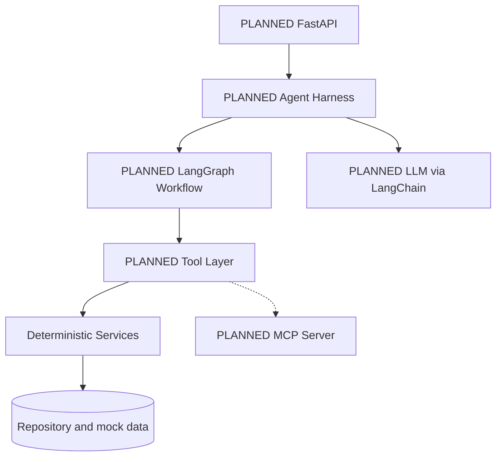
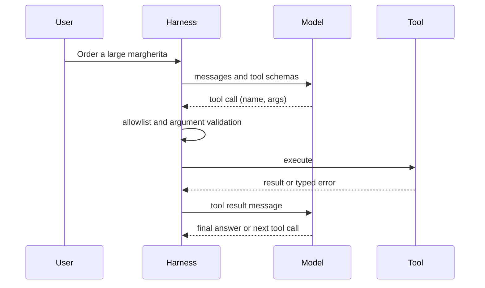
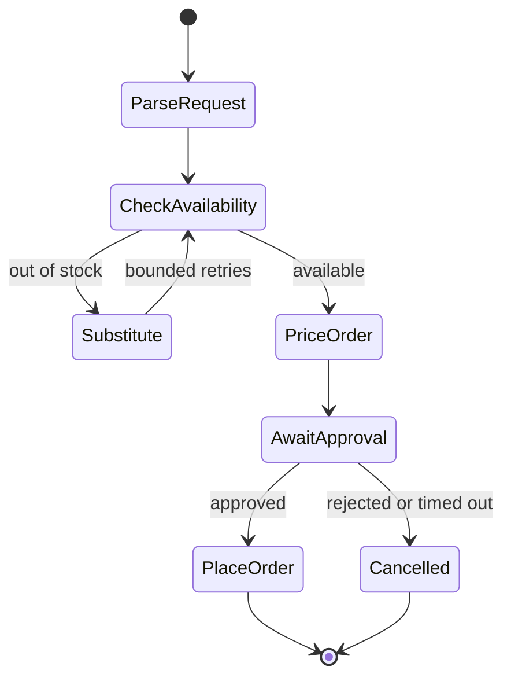
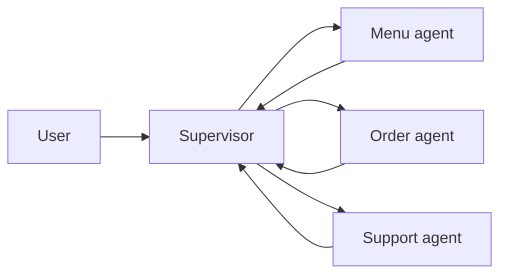
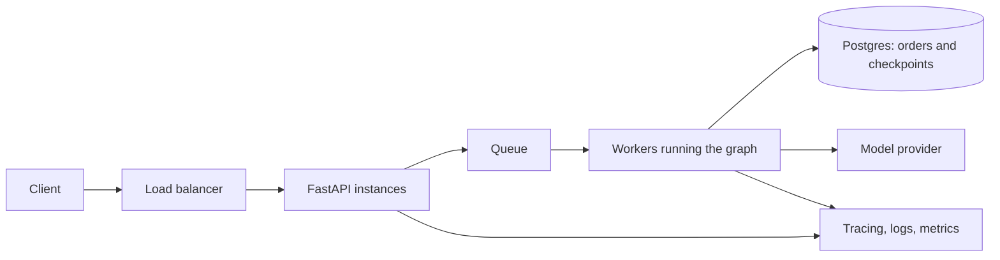

# Architecture

Items marked PLANNED are not implemented yet. Nothing in this repository is implemented until its issue is closed with passing tests.

## 1. Layers

Rule: dependencies point downward only. Services never import tools, graphs, or LLM code. Each layer is tested without the layer above it.

## 2. Initial deterministic application (M1)

Services for menu, pricing, and orders with an injected repository, typed models, and typed domain errors. No LLM and no network. Tests call services directly. This is the source of truth for all business rules; later layers only call it.

## 3. Eventual LLM-enabled architecture (M2 onward, PLANNED)

The LLM interprets user intent and chooses tools. It never holds business rules and never performs side effects itself. Everything it requests passes through the harness, which validates, authorizes, executes, and logs. Model providers are hidden behind one factory so they can be swapped by configuration.

## 4. Tool-calling lifecycle (PLANNED)

The model only requests a call; your code validates and executes it. Failures return to the model as structured results. A step budget caps the loop. Sequential calls depend on earlier results; parallel calls are independent and results must be matched to call ids.

## 5. Graph execution and state transitions (PLANNED)

State is a typed schema. Each node returns a partial update; reducers define how concurrent updates to one key merge. A checkpoint is saved per thread after each step. The approval interrupt sits immediately before PlaceOrder, and PlaceOrder is idempotent so a replay cannot create a second order. Open question to settle by experiment: which nodes re-run on resume (see DECISIONS.md).

## 6. Agent-harness responsibilities (PLANNED)

The harness owns: step budget, tool allowlist, per-call and total timeouts, retry policy (transient errors only), argument validation, authorization per user, context trimming, audit logging, termination conditions, and idempotency keys for side effects. The model owns none of these.

## 7. Memory and checkpointing boundaries (PLANNED)

| Data | Home | Reason |
|---|---|---|
| Current graph state, pending approval | Checkpoint (per thread) | Lets one run pause and resume |
| Orders, customers, idempotency keys | Relational database | Transactional source of truth |
| Customer preferences | Long-term store (relational first) | Survives across threads |
| Menu and FAQ passages | Vector index only if experiments justify it | Fuzzy semantic lookup |
| Raw conversation history | Trimmed or summarized in state; full copy in audit log | Context window limits |

Checkpoint is run state for resuming. Memory is knowledge that outlives a run. They are different stores with different lifetimes.

## 8. Multi-agent communication (PLANNED, justified only by measurement)

Specialists get restricted tool sets and isolated working state. They return typed results to the supervisor; they do not share raw message history. A single-agent baseline must exist first. If the baseline wins on accuracy, cost, and latency, the multi-agent design is not adopted.

## 9. External tool integration (PLANNED)

MCP server exposes menu and order tools; the agent consumes them as an MCP client. Tools from any external server are untrusted: they pass the same allowlist, validation, and audit controls. A2A is an optional experiment in experiments/a2a to study agent-to-agent boundaries and contracts.

## 10. Error handling and security boundaries (PLANNED)

Trust boundaries: user input, model output, tool output, retrieved documents, and MCP responses are all untrusted. Domain errors are typed with codes. Transient errors are retried with backoff; permanent errors are not. Side effects require idempotency keys and human approval. Authorization is checked in the harness against the authenticated user, never from model-supplied identity. Secrets come from environment configuration and never appear in logs or prompts.

## 11. Production deployment (PLANNED)

The API accepts requests and returns a job id for long runs; workers execute graphs; Postgres holds orders and checkpoints; observability covers every hop. Decisions about queues, async model, and scaling are open and recorded as ADRs.
